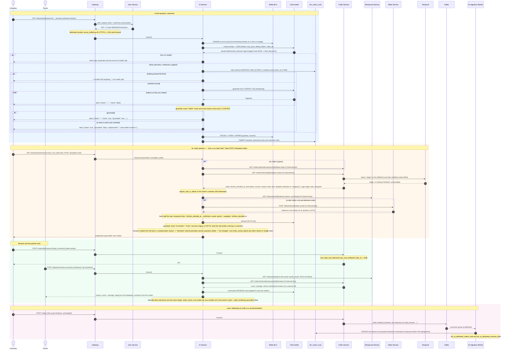

# SmartFoodOps — AI Assistant Sequence Diagram

How a question becomes a streamed, grounded answer; how an order is explained; how reviews and the
partner tools work; and how an order is later attributed to a recommendation. Verified against
`services/ai/apis/{assistant,explain,partner}.py`, `services/ai/agents/{graph,router,context,prompts}.py`,
`services/ai/{guardrails,order_explainer,partner,memory,llm,attribution}.py`,
`services/ai/repositories/interactions.py`, `services/order/apis/{reviews,internal_explain}.py`,
`services/order/clients/orchestrator.py`, `services/rider/apis/dispatch.py` and
`api-gateway/nginx.conf`. The reasoning is in [D63–D65](../key-decisions.md) and the phased build in
[week5-ai-assistant-plan.md](../week5-ai-assistant-plan.md). Retrieval itself (vector, analytics,
courier) is drawn in [ai_search_sequence_diagram.md](ai_search_sequence_diagram.md).

As in the Week 4 diagram, the gateway's `auth_request` round trip (D51/D57) is drawn once per section.
Calls marked `[X-Internal-Key]` use the shared service-to-service key (D15); none of those routes has a
`route_permissions` row, so the gateway refuses them even for an admin's bearer.

