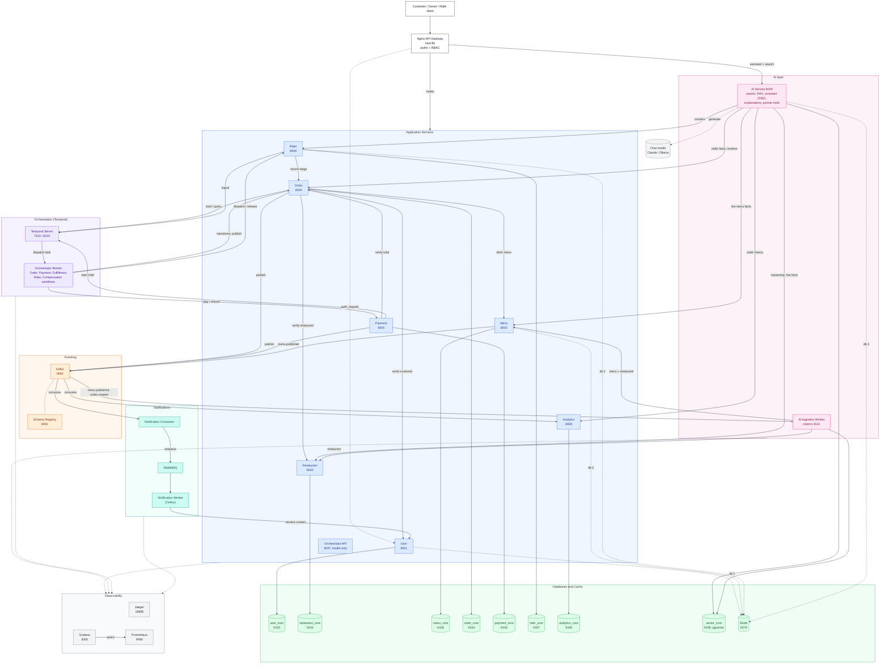

# SmartFoodOps — Complete System Architecture

Every container in `docker-compose.yml`, with real host/container ports and the actual
dependency graph — not an idealized version. See
[readme/key-decisions.md](../key-decisions.md) for the D-numbers behind the shape (D01
database-per-service, D25/D54 orchestration over choreography — order creation itself
happens inside the saga, started by the API and awaited for its result, D58, D36 the orchestrator split, D38 Kafka
carries facts / Temporal owns decisions, D47 services hold their own Temporal client, D51
the gateway's `auth_request` chokepoint, D52 internal calls asserting identity headers
instead of forwarding the bearer token, D53 the transactional outbox tables are removed in
favour of a Temporal-activity publish, D55 payment/rider/compensation become child
workflows, D57 RBAC moves into the database and is enforced at the gateway, D58 checkout
starts `OrderWorkflow` and answers after payment, with the post-payment work in an abandoned
`FulfillmentWorkflow`, and — for Part B — D59 the AI Service with its own pgvector database, D60
owner-declared menu tags, D61 `menu.published` feeding an ingestion worker, D62 the RAG context
assembler; and for Week 5 — D63 the streaming assistant as a LangGraph with a code-enforced grounding
check, D64 order explanations, reviews and partner tools over internal routes, D65 conversion
attributed from `order.created`, D66 the vector tables keep only the chunk and its embedding while search reads facts live from the
Menu and Restaurant Services).

The AI layer (pink) is two containers from one image: `ai-service` answers search and RAG-context
requests (gated at the gateway like every other route, `ai:search` / `ai:rag_context`), and
`ai-ingestion-worker` consumes `menu.published`, re-reads the menu and restaurant over internal-key
routes, and keeps `sfo_vector_core` in step. RAG context also reads the Analytics and Rider services,
and degrades — naming the failed source — rather than failing when one is down.

Week 5 adds, to the same two containers: the streaming assistant (`GET /ai/assistant/stream`, SSE through
a gateway location with buffering off), order explanations, and the restaurant-admin authoring tools. The
AI Service reads the Order Service (order, reduced trail, saga stage, reviews) and the Rider Service
(courier distance) over internal-key routes, keeps conversation memory in Redis db 3, and calls a chat
model — the one new dependency that leaves the stack. The ingestion worker also consumes `order.created`
to attribute orders to recommendations.

Every `Gateway -->` edge below implies a preceding `auth_request` round trip to the User
Service's internal verify endpoint (D51) — drawn once, explicitly, as the dotted edge into
`UserSvc`, rather than repeated on each application-service edge. That round trip decides
two things, not one (D57): whether the token is valid, and whether the caller's roles carry
the permission the requested route demands, read from `route_permissions`/`role_permissions`
in `sfo_user_core`. So a `403` is as likely to come from that dotted edge as a `401`, and a
wrong-role request never reaches the service it was aimed at. A successful verify sets
`X-User-Id`/`X-User-Roles`/`X-User-Permissions`, which the gateway attaches to the forwarded
request and which every `-->|verify ...|` edge between application services below now carries
in place of a forwarded bearer token (D52) — login, register, refresh and every `/health`
route are the exceptions, reachable with no token at all.

Nodes are color-coded by subsystem (application services, the Temporal saga, Kafka/schema-registry eventing, the
notification bridge, AI, databases, observability) so a line's color/region tells you what it belongs to even where
paths cross. To keep the picture readable, an arrow into a box means "every service in it": all application services
and the saga, notification and AI containers trace to Jaeger and expose `/metrics` to Prometheus, and every producer
and consumer validates against the Schema Registry. Edge labels are short; the decision numbers are in the notes below.

## Notes on the edges

- **Chat client:** the gateway also serves a static page, `chat-ui/index.html`, at `/chat/`. It is public (it is only HTML) and
  calls the same gated routes as any client, with the signed-in customer's own bearer token.
- **Gateway (D51/D57):** the dotted `auth_request` edge decides token validity and the route's permission from
  `route_permissions`/`role_permissions`; a `403` can come from it as readily as a `401`. A success sets
  `X-User-Id`/`X-User-Roles`/`X-User-Permissions`, which service-to-service calls carry instead of a bearer token (D52).
- **Saga (D47, D55, D58):** `OrderWorkflow` creates, pays and confirms; payment, rider and compensation are child
  workflows; the post-payment work runs in an abandoned `FulfillmentWorkflow`. The Order Service also runs read-only
  stage Queries for order explanations (D64), and the kitchen decision is an Update on `FulfillmentWorkflow`.
- **Eventing (D38, D53, D61):** Kafka carries facts, Temporal owns decisions. Each service publishes through a
  `KafkaGateway` called from an internal endpoint a Temporal activity invokes. The Menu publish is best-effort.
- **AI (D59-D66):** the vector tables hold only ids, chunk text, hash and embedding (D66); search finds candidates by vector
  and reads each dish's and restaurant's facts live from the Menu and Restaurant Services. Reads go over internal-key routes, never other services' databases. RAG context degrades, naming the
  failed source, if Analytics or Rider is down. The worker also consumes `order.created` to attribute orders to
  recommendations (D65). Conversation memory is Redis db 3 (D63). The chat model is the one dependency outside the stack.
- **Data (D01, D49):** one database per service; the vectors are derived state in the AI Service's own database; rider
  live location is a Redis GEO index (db 2).
